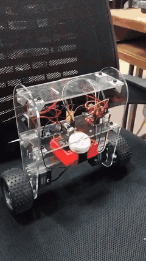
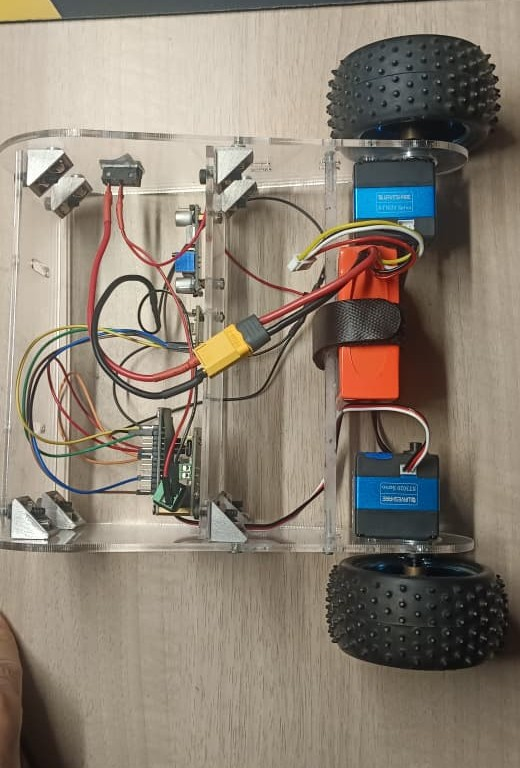
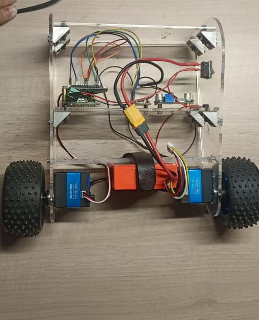
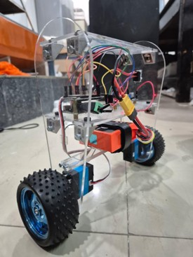
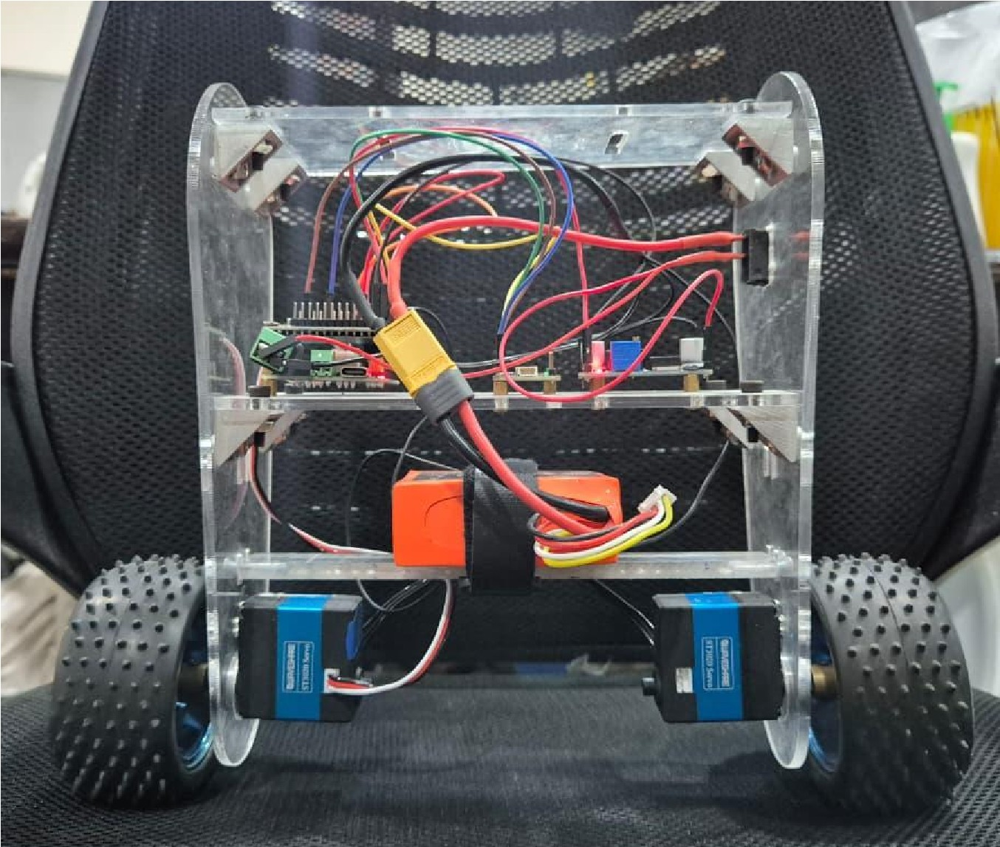
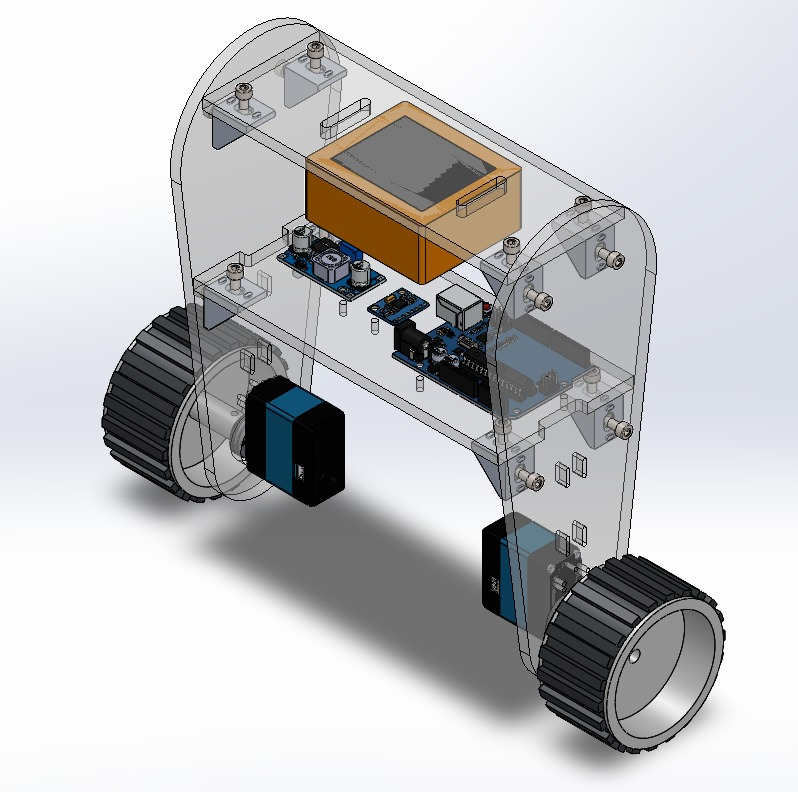
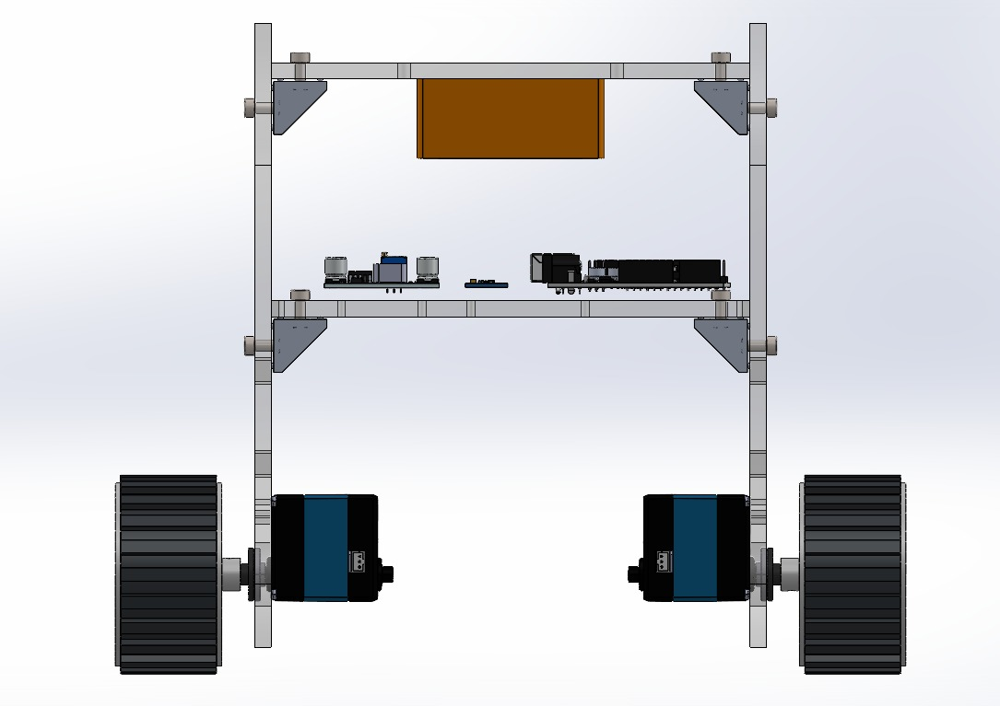
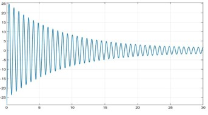

# Self-Balancing Robot

A two-wheeled inverted-pendulum robot that balances itself using a BNO085 IMU and a PID controller on an ESP32, driving two Waveshare ST3020 serial bus servos. Built as a 5-member team project at Thapar Institute of Engineering and Technology.



[Full demo video](media/demo_full.mp4)






## My contribution
This repository is my personal copy of the project. My part:
- **Control:** wrote the ESP32 firmware (IMU read-out, PID loop, tilt cut-off) and tuned the PID gains on the real robot
- **Electronics:** selected the components, built the bill of materials, and did all the wiring and power distribution
- **Tooling:** wrote a Python GUI for live PID tuning over serial
- **Mechanical:** made the first CAD iteration; the final CAD was done by a teammate

Teammates handled the final CAD, MATLAB modelling and project documentation.

## Hardware (bill of materials)
| Part | Details |
|------|---------|
| Microcontroller | ESP32-WROOM-32 |
| IMU | Adafruit 9-DOF Orientation IMU Fusion Breakout - BNO085 (STEMMA QT / Qwiic) |
| Actuators | 2 x Waveshare ST3020 serial bus servo (25 kg.cm, 360 degree magnetic encoder) |
| Servo driver | Waveshare Serial Bus Servo Driver Board (ST/SC series) |
| Battery | Pro-Range NMC 18650 pack, 11.1 V 2000 mAh 10C, 3S1P |
| Regulator | LM2596S DC-DC buck converter (powers the ESP32) |
| Wheels | 85 mm rubber wheels |
| Chassis | Laser-cut acrylic plates, designed in SolidWorks |

**Power:** battery -> servo driver board -> servos; battery -> LM2596S buck converter -> ESP32.

**Pin connections (from firmware)**

| Signal | ESP32 pin |
|--------|-----------|
| IMU I2C SDA / SCL | GPIO 21 / GPIO 22 |
| Servo bus UART2 TX / RX | GPIO 17 / GPIO 16 (1 Mbaud) |
| Servo IDs | 1 and 2 |

## How it works
1. **Sensing:** the BNO085 outputs an orientation quaternion at 200 Hz. Pitch is computed from it and trimmed by a fixed offset (-0.15 rad) to match the robot's mechanical balance point.
2. **Control:** a PID loop on pitch error computes a speed command:
   `output = Kp*e + Ki*integral(e) + Kd*de/dt`
   with integral clamping (anti-windup) and the output limited to +/-10000.
3. **Actuation:** the command is sent over the serial bus to the two servos in wheel mode, with opposite signs because they are mounted mirrored.
4. **Safety:** if tilt exceeds 30 degrees, both motors are stopped, since the servos cannot produce enough torque to recover from larger angles.
5. **Live tuning:** gains can be changed over serial without reflashing.

**Final gains:** Kp = 58000, Ki = 1.2, Kd = 500, tuned by trial and error on the real robot. The values are large because the output is in servo speed units, not PWM duty.

## Results
- Balances continuously with a small oscillation
- Recovers from light pushes (not hard ones)
- Motors cut off beyond the tilt limit

## PID tuning tool
```bash
pip install -r requirements.txt
python tools/pid_tuner.py
```
Select the ESP32's COM port, connect, and adjust Kp/Ki/Kd. The tool sends `PID:kp,ki,kd` at 115200 baud.

## Mechanical design
Designed in SolidWorks (files and a STEP export in `cad/`). Initial iteration by me, final iteration by a teammate.




## Modelling and simulation
A teammate modelled the system in MATLAB/Simulink. Simulation output:



## Electronics
Power and signal connections are described in [`electronics/README.md`](electronics/README.md). A wiring diagram for the final design is planned.

## Challenges and what I learned
- **Arduino limits:** the Arduino Uno was too slow and short on memory for real-time sensor fusion and a fast control loop, which hurt stability. Moving to the ESP32 fixed this.
- **Motor driver and protocol:** the motors did not respond at first because the microcontroller cannot supply enough current directly. The ST3020 servos also use a serial bus protocol, so they needed the UART servo driver board; once it was added, they worked reliably. I learned to check current ratings and communication protocols when choosing actuators.
- **Power and wiring:** loose wiring and unregulated power caused resets and erratic motor speeds. A buck converter for the ESP32 and a cleaner wiring layout made the system far more reliable.
- **Why ST3020 servos:** small, efficient and light compared with DC motors.

## Next iteration
Make the robot more robust so it can handle harder pushes.

## Build and flash
- Arduino IDE with ESP32 board support
- Libraries: `Adafruit BNO08x`, `SCServo`
- Open `code/selfbalancing/selfbalancing.ino`, select your ESP32 board, upload
